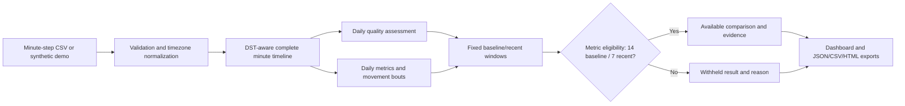

# SIGNAL LAB

SIGNAL LAB turns timestamped, minute-level step counts into a transparent personal movement fingerprint. It shows how observed movement is distributed across bouts, summarizes cadence, compares fixed periods of a person's own history, and makes data-quality limits visible beside every result.

It is a hackathon prototype for descriptive personal analytics. It is not a medical device, clinical decision tool, or wearable-data authentication system.

## What is implemented

- Strict CSV validation with timezone handling, duplicate/conflict detection, source/device consistency checks, and documented non-wear handling.
- DST-aware complete local-day minute grids. Missing minutes are never converted into zero steps.
- Usable-minute coverage assessment using a configurable 95% prototype threshold.
- Observed daily steps, movement bouts, peak one-minute cadence, and top-30 cadence.
- Fixed-window within-person comparisons with per-metric eligibility and intentional withheld states.
- A Streamlit dashboard with complete and degraded synthetic demos, CSV upload, consent, and session reset.
- Per-metric evidence records, stable evidence IDs, SHA-256 input fingerprints, JSON/CSV/HTML exports, and offline-safe HTML escaping.

## Requirements and setup

Supported Python: **3.11+**. The project was most recently tested with Python 3.14.

### Windows PowerShell

```powershell
git clone https://github.com/Dhyan-S-Kanapadi/SIGNAL-LAB.git
cd SIGNAL-LAB
py -3.11 -m venv .venv
.\.venv\Scripts\Activate.ps1
python -m pip install --upgrade pip
python -m pip install -r requirements-dev.txt
streamlit run app.py
```

### macOS / Linux

```bash
git clone https://github.com/Dhyan-S-Kanapadi/SIGNAL-LAB.git
cd SIGNAL-LAB
python3.11 -m venv .venv
source .venv/bin/activate
python -m pip install --upgrade pip
python -m pip install -r requirements-dev.txt
streamlit run app.py
```

Open the local URL printed by Streamlit (normally `http://localhost:8501`). Runtime-only dependencies are in `requirements.txt`; test tooling is in `requirements-dev.txt`.

## Demos and CSV input

In the sidebar, select **Complete synthetic demo** for an eligible comparison or **Demo with missing data** to see recent comparisons withheld because only six recent days qualify. Check the explicit session-processing consent box to run either report. The Evidence & export tab includes a downloadable example CSV.

CSV must contain these columns:

| Column | Required | Meaning |
| --- | --- | --- |
| `timestamp` | Yes | A minute-aligned timestamp. Naive timestamps are interpreted in the selected local timezone. |
| `steps` | Yes | Finite, non-negative integer steps recorded during that minute. Blank means missing. |
| `source` | No | One source value for the analysis. |
| `device` | No | One device value for the analysis. |
| `worn` | No | `true`, `false`, or blank. `false` is documented non-wear and cannot have positive steps. |

```csv
timestamp,steps,source,device,worn
2025-02-01 08:00,32,Example export,Example watch,true
2025-02-01 08:01,0,Example export,Example watch,true
2025-02-01 08:02,,Example export,Example watch,
```

The third row is missing, not a recorded zero. Sub-minute rows, ambiguous naive DST timestamps, mixed naive/aware timestamps, conflicting same-minute records, and multi-source/device input are rejected with an explanation.

## How the report is calculated

### Data quality

A local calendar day qualifies only when it is completed and at least 95% of its expected local minutes have usable observations. Known non-wear is not usable. The 95% cutoff is a configurable prototype policy, not a clinically validated threshold. Unknown wear remains unknown: a complete record does not prove that the device was worn.

### Daily metrics

- **Observed daily steps:** sum of usable observed counts; missing values are not filled.
- **Movement bouts:** consecutive positive usable minutes. Zeros, missing minutes, non-wear, and midnight end a bout. Buckets are `<5`, `5-<10`, `10-<15`, and `15+` minutes.
- **Peak 1-minute cadence:** maximum usable minute-step count for the day.
- **Top-30 cadence:** mean of the 30 highest usable minute counts, including recorded zeros. It is undefined with fewer than 30 usable observations.

### Comparison windows

The latest completed represented local date is the anchor. The **recent** window is its latest 10 completed calendar dates; the **baseline** is the 20 immediately preceding calendar dates. Excluded days are not replaced with older days.

Each metric needs at least 14 qualifying baseline days and 7 qualifying recent days. The report compares median daily steps, median daily peak cadence, and median daily top-30 cadence. Long-bout share is calculated separately per window as `100 x steps in 15+ minute bouts / observed steps`; changes in this share are expressed in percentage points. Zero baselines and undefined results remain explicit rather than being forced into a percentage.

Rhythm values (IS, IV, and M10) are intentionally withheld. They require suitable wear evidence and a separately validated rhythm module.

## Evidence and privacy

Every exported metric includes its calculation version, values, windows, qualifying counts, coverage summary, source/device metadata, formula, limitations, input SHA-256 fingerprint, and deterministic evidence ID. The fingerprint identifies the analyzed bytes; it does **not** authenticate a sensor measurement.

Uploads are held only in the Streamlit session's application memory; the app does not write uploads to disk, use global/shared data caching, call external AI services, or require API keys. When run locally, processing occurs locally. A hosted deployment processes records on that host. **Clear session data** removes retained app state and resets the upload widget, but does not claim secure erasure of memory.

## Limitations

- Synthetic demos are clearly labelled and are not participant data or PMData P01.
- The app does not integrate with real wearable APIs or authenticate sensor measurements.
- It does not infer wear from zero steps, infer causes of changes, assess disease/fitness/recovery, or make clinical/statistical-significance claims.
- It intentionally omits rhythm metrics pending separate validation and suitable wear evidence.

## Testing

```bash
python -m pytest -q
python -m compileall -q app.py signal_lab tests
python -m streamlit run app.py --server.headless true
```

## High-level design


